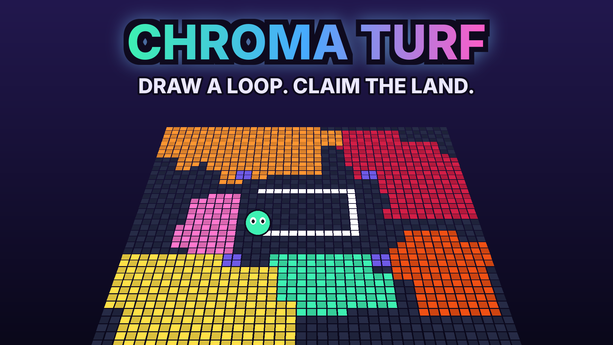

# Chroma Turf

**Draw a loop. Claim the land. Cut their trail.** — an original multiplayer territory arena for Roblox.



Step out of your zone to draw a glowing trail, loop back home and everything inside becomes yours.
Touch a rival's trail and their whole turf is wiped. 3-minute rounds, 3 arenas, power-ups, bots that
keep every server lively, daily quests, 100 levels and 34 fair (cosmetic-only) unlockables.

## Quick start

```bash
./scripts/build.sh   # -> release/ChromaTurf.rbxlx, open in Roblox Studio
./scripts/ci.sh      # syntax + lint + format + 50 tests + build + place verification
```

Tooling: Rojo 7.7, Lune 0.11, Selene, StyLua (see docs/INSTALL.md).

## Documentation

| | |
|---|---|
| [PROJECT_STATE.md](PROJECT_STATE.md) | where things stand, what's blocked |
| [docs/GDD.md](docs/GDD.md) | game design |
| [docs/MARKET_RESEARCH.md](docs/MARKET_RESEARCH.md) | research, concepts, weighted matrix |
| [docs/ARCHITECTURE.md](docs/ARCHITECTURE.md) | code structure, networking, persistence |
| [docs/INSTALL.md](docs/INSTALL.md) | setup, build, tests |
| [docs/PUBLISHING.md](docs/PUBLISHING.md) | publish steps, QA checklist, store copy, shorts ideas |
| [docs/MONETIZATION.md](docs/MONETIZATION.md) | passes, products, price hypotheses, metrics |
| [docs/ANALYTICS.md](docs/ANALYTICS.md) | events, KPI formulas, experiments |
| [docs/EXTERNAL_SETUP.md](docs/EXTERNAL_SETUP.md) | account-side actions required |
| [docs/PERFORMANCE.md](docs/PERFORMANCE.md) | budgets and measurements |
| [DECISIONS.md](DECISIONS.md) · [ROADMAP.md](ROADMAP.md) · [KNOWN_ISSUES.md](KNOWN_ISSUES.md) · [TEST_RESULTS.md](TEST_RESULTS.md) · [IMPLEMENTATION_LOG.md](IMPLEMENTATION_LOG.md) | continuity |
